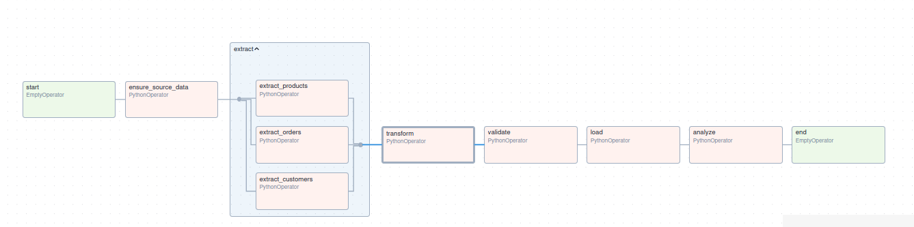
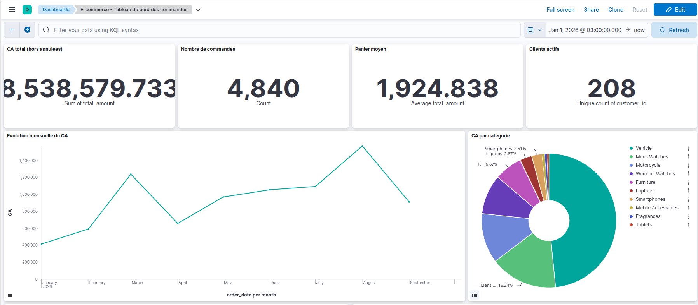

# Pipeline ETL E-commerce : Airflow, Elasticsearch, Kibana

Projet final de Data Engineering. Un pipeline automatisé qui collecte les commandes d'une boutique en ligne, les nettoie, contrôle leur qualité, les charge dans Elasticsearch et les expose dans un dashboard Kibana.

> **Auteur :** _RANDRIANAIVOLALAINA Alpha_ · **Domaine :** e-commerce et commandes

---

## 1. Contexte

Une boutique en ligne dispose de ses commandes (export CSV) et de son catalogue produits et de sa base clients (exposés par une API REST). Ces sources sont brutes (doublons, valeurs manquantes, dates dans plusieurs formats, identifiants inconnus) et ne permettent pas de piloter l'activité.

Questions métier auxquelles le projet répond :

- Comment évolue le chiffre d'affaires mois par mois ?
- Quelles catégories et quels produits rapportent le plus ?
- Dans quels États le panier moyen est-il le plus élevé, et où annule-t-on le plus ?
- Quels moyens de paiement et quels jours de la semaine dominent ?

## 2. Architecture

```
 API REST DummyJSON            CSV commandes
 (products, customers)          (orders.csv)
            └──────────────┬─────────────┘
                           ▼
   ┌─────────────────────── Apache Airflow (@daily) ───────────────────────┐
   │ ensure_source_data → extract (3 tâches) → transform → validate → load │ → analyze
   └───────────────────────────────────────────────────────────────────────┘
                                                              │
                                                              ▼
                                                   Elasticsearch (index ecommerce_orders)
                                                              │
                                                              ▼
                                                   Kibana (dashboard)
```

| Service | Rôle | URL |
|---|---|---|
| Airflow | Orchestration du pipeline | http://localhost:8080 (admin / admin) |
| Elasticsearch 8.13 | Stockage et agrégations | http://localhost:9201 |
| Kibana 8.13 | Visualisation | http://localhost:5602 |
| PostgreSQL | Métadonnées d'Airflow | interne |

## 3. Sources de données

Le pipeline combine **deux types de sources** :

| Source | Type | Contenu | Volume |
|---|---|---|---|
| `https://dummyjson.com/products?limit=0` | **API REST** publique | catalogue : `id, title, category, price` | 194 produits |
| `https://dummyjson.com/users?limit=0` | **API REST** publique | clients : `id, nom, email, address (ville, État, pays)` | 208 clients |
| `data/raw/orders.csv` | **Fichier CSV** | commandes : `order_id, customer_id, product_id, quantity, order_date, status, payment_method, discount` | ~5 150 lignes |

**Pourquoi les commandes sont un CSV simulé.** Aucune API publique ne fournit un historique de commandes réaliste, daté et volumineux. Le fichier `orders.csv` simule donc l'export des commandes de la boutique. Il est versionné dans le dépôt, généré avec une graine fixe par `scripts/generate_data.py` (résultat reproductible), et référence les identifiants clients (1..208) et produits (1..194) de l'API. Si le fichier est supprimé, la première tâche du DAG le régénère.

Le CSV contient volontairement des défauts : doublons, quantités manquantes ou négatives, dates en `AAAA-MM-JJ` et en `JJ/MM/AAAA`, clients inconnus.

**Robustesse de l'API.** Chaque appel réussi est sauvegardé dans `data/raw/api_<source>.json`. Si l'API est injoignable lors d'une exécution suivante, ce snapshot est utilisé (un avertissement apparaît dans les logs). Sans snapshot, la tâche échoue et Airflow la relance (retries).

## 4. Pipeline Airflow

DAG `ecommerce_etl_pipeline` (`dags/etl_pipeline.py`) :

| Tâche | Script | Rôle |
|---|---|---|
| `ensure_source_data` | `generate_data.py` | Régénère `orders.csv` s'il est absent |
| `extract.extract_orders` (CSV), `extract.extract_customers` et `extract.extract_products` (API) (TaskGroup, en parallèle) | `extract.py` | Lit le CSV et appelle l'API, dépose le tout dans `data/staging/` |
| `transform` | `transform.py` | Nettoyage, jointures, enrichissement |
| `validate` | `validate.py` | Contrôles qualité, échec bloquant |
| `load` | `load.py` | Crée l'index (mapping) et charge en bulk |
| `analyze` | `analyze.py` | Exécute `queries.json` et sauvegarde les résultats |

Fonctionnalités Airflow utilisées :

- **Planification** : `schedule="@daily"`, `catchup=False`.
- **Dépendances** entre plusieurs tâches, dont un **TaskGroup**.
- **PythonOperator** pour toutes les étapes.
- **Connection** `elasticsearch_default` (définie dans `docker-compose.yml`, lue par `load.py` via `BaseHook`).
- **Retries** : 2 tentatives, 1 minute d'attente.
- **Logs** détaillés à chaque étape (visibles dans l'interface Airflow).
- **XCom** : les tâches d'extraction renvoient chemin et nombre de lignes, `transform` les récupère, puis `validate` et `load` récupèrent le résultat de `transform`. Seules des métadonnées circulent, jamais les données elles-mêmes.
- **Variable** `es_index` (nom de l'index) lue via un template Jinja.
- **Template** : `{{ ds }}` (date logique) alimente le champ `etl_run_date`.
- **Notification d'échec** : `on_failure_callback` (écrit dans les logs, remplaçable par un e-mail ou Slack).
- **Contrôle qualité** : si `validate` échoue, `load` et `analyze` ne s'exécutent pas.



## 5. Transformations

Sept transformations dans `scripts/transform.py` :

1. **Suppression des doublons** sur `order_id` (et `customer_id`, `product_id` par sécurité).
2. **Conversion de types** : `quantity` en entier, `discount` et `price` en numérique.
3. **Valeurs manquantes** : `discount` → 0, `payment_method` → `unknown`, localisation → `Unknown`, lignes sans client, produit, quantité ou date supprimées.
4. **Normalisation des dates** : deux formats sources vers un ISO 8601 unique.
5. **Filtrage** des quantités nulles ou négatives.
6. **Normalisation du texte** : catégories de l'API (`mens-shirts` → `Mens Shirts`), e-mails en minuscules, noms propres, statuts en minuscules.
7. **Jointures** commandes × clients × produits, puis **nouvelles colonnes** : `total_amount`, `order_month`, `order_weekday`, `is_high_value` (≥ 500), `is_cancelled`, `etl_run_date`.

Résultat typique : 5 150 lignes brutes → ~4 840 lignes propres (150 doublons, ~100 lignes incomplètes, ~40 quantités invalides, ~20 clients inconnus retirés).

## 6. Contrôles qualité

`scripts/validate.py` vérifie : nombre de lignes > 0, rétention ≥ 80 % des lignes brutes, champs obligatoires non nuls, unicité de `order_id`, types et valeurs (`quantity` > 0, `unit_price` > 0, `total_amount` ≥ 0), statuts autorisés, dates plausibles, cohérence de `total_amount` avec `quantity × unit_price × (1 - discount)`.

Le rapport est écrit dans `data/staging/validation_report.json`. Un seul contrôle en échec fait échouer la tâche.

## 7. Elasticsearch

- **Index** : `ecommerce_orders` (1 shard, 0 réplique, adapté à un cluster mono-nœud).
- **Mapping** strict dans [`elasticsearch/mapping.json`](elasticsearch/mapping.json) :

| Champ | Type | Champ | Type |
|---|---|---|---|
| `order_id`, `customer_id`, `product_id` | keyword | `quantity`, `is_cancelled` | integer |
| `customer_name`, `product_name` | text + keyword | `unit_price`, `discount`, `total_amount` | float |
| `email`, `country`, `state`, `city`, `category` | keyword | `order_date` | date |
| `status`, `payment_method` | keyword | `etl_run_date` | date (`yyyy-MM-dd`) |
| `order_month`, `order_weekday` | keyword | `is_high_value` | boolean |

- **Chargement idempotent** : `_id = order_id`, donc relancer le DAG ne crée aucun doublon.

## 8. Analyses

Les 9 requêtes d'agrégation sont dans [`elasticsearch/queries.json`](elasticsearch/queries.json). Leurs résultats sont écrits dans `data/analysis_results.json` par la tâche `analyze`.

| Requête | Question |
|---|---|
| `global_kpis` | CA, panier moyen, clients actifs, commandes (hors annulées) |
| `revenue_per_month` | Évolution mensuelle du CA |
| `revenue_by_category` | Catégories les plus rentables |
| `top_10_products` | 10 produits les plus rentables |
| `payment_methods` | Moyens de paiement les plus utilisés |
| `cancellation_rate_by_state` | Taux d'annulation par État |
| `avg_basket_by_state` | États au panier moyen le plus élevé |
| `orders_by_weekday` | Jours les plus actifs |
| `high_value_orders_by_category` | Catégories des commandes ≥ 500 |

**Constats principaux** (commandes non annulées, sauf mention contraire)

1. **Un CA très concentré sur quelques catégories.** Le chiffre d'affaires total atteint
   environ 8,54 M$ pour 4 436 commandes (panier moyen ≈ 1 925 $). La catégorie *Vehicle*
   en réalise à elle seule près de 48 % (4,07 M$), et avec *Mens Watches* et *Motorcycle*,
   les trois premières catégories pèsent environ 75 % du CA. Les meilleurs produits sont
   des véhicules (300 Touring : 1,14 M$) et des montres de luxe (Rolex Cellini Moonphase,
   le plus commandé du top avec 32 commandes).

2. **Une activité en croissance de janvier à août, puis un léger recul.** Les commandes
   mensuelles passent de 184 en janvier à 715 en août (environ ×3,9), puis retombent à 616
   en septembre. Le CA suit la même tendance, avec un pic en août (1,58 M$) et un
   second sommet en mars (1,24 M$, malgré moins de commandes qu'en avril ou mai). Le CA
   est irrégulier d'un mois à l'autre, car le panier varie énormément selon les produits
   achetés (véhicules et montres de luxe contre petits articles).

3. **Un paiement par carte largement dominant.** La carte représente environ 54 % des
   commandes, devant PayPal (19 %), le mobile money (15 %) et le paiement à la livraison (10 %).
   Environ 2 % des commandes n'ont pas de moyen de paiement renseigné (`unknown`).

4. **Un taux d'annulation homogène, autour de 8 %.** Sur l'ensemble des commandes, 404 sur
   4 840 sont annulées (≈ 8,3 %). Parmi les États les plus actifs, le taux reste entre
   7,9 % (Arkansas) et 9,5 % (Vermont) : aucun État ne se démarque.

5. **Des commandes à forte valeur (≥ 500 $) surtout dans l'ameublement et les smartphones.**
   *Furniture* (187) et *Smartphones* (141) comptent le plus de commandes à forte valeur.
   Toutes les commandes de *Vehicle* (76) et de *Motorcycle* (73) en font partie.

**Limites à garder en tête.** La répartition géographique n'a pas de valeur réelle : l'API
DummyJSON associe villes et États au hasard, donc les différences de panier moyen par État
(ex. Georgia ≈ 4 660 $) reposent sur peu de commandes très chères et ne sont pas
interprétables. Les commandes sont de plus simulées (voir section 3) : les tendances de volume
et de répartition par jour de la semaine reflètent la génération du fichier, pas un
comportement client réel.

## 9. Dashboard Kibana

Fichier : [`kibana/dashboard.ndjson`](kibana/dashboard.ndjson) (data view, 11 visualisations, 1 dashboard).

| Visualisation | Type |
|---|---|
| CA total, nombre de commandes, panier moyen, clients actifs | Metric (×4) |
| Évolution mensuelle du CA | Courbe |
| CA par catégorie | Donut |
| CA par État (top 10) | Barres horizontales |
| Top 10 produits | Tableau |
| Moyens de paiement | Camembert |
| Commandes par jour de la semaine | Barres verticales |
| Commandes par statut | Barres verticales |



## 10. Lancer le projet

**Prérequis** : Docker et Docker Compose, ~4 Go de RAM disponibles pour Docker, et un accès internet (appels à l'API dummyjson.com).

```bash
git clone <url-du-depot> && cd projet-data-engineering

# Linux uniquement (droits sur les dossiers montés)
echo "AIRFLOW_UID=$(id -u)" > .env

# 1. Construire et démarrer la stack (premier démarrage : quelques minutes)
docker compose up -d --build

# 2. Attendre que tout soit prêt
docker compose ps
```

1. Ouvrir Airflow sur http://localhost:8080 (`admin` / `admin`).
2. Activer le DAG `ecommerce_etl_pipeline` (interrupteur), puis le déclencher avec ▶ **Trigger DAG**.
3. Suivre l'exécution dans la vue **Graph** et cliquer sur une tâche, puis **Logs**.
4. Vérifier les données : `curl "http://localhost:9201/ecommerce_orders/_count?pretty"`
5. Importer le dashboard : `./kibana/import_dashboard.sh`
   (ou Kibana → Stack Management → Saved Objects → Import → `kibana/dashboard.ndjson`)
6. Ouvrir Kibana : http://localhost:5602 → Dashboards → **E-commerce - Tableau de bord des commandes**.
   Si le dashboard est vide, élargir la période (en haut à droite) : les données couvrent janvier à septembre 2026.

Arrêter : `docker compose down` (ajouter `-v` pour effacer aussi les données).

### Exécuter les scripts sans Airflow (optionnel)

```bash
python -m venv .venv && source .venv/bin/activate
pip install -r requirements.txt
python -m tests.test_offline      # teste Extract -> Transform -> Validate avec une API simulée
```

## 11. Structure du dépôt

```
dags/etl_pipeline.py            DAG Airflow
scripts/                        extract, transform, validate, load, analyze, generate_data, config
tests/test_offline.py           test hors-ligne (API simulée) : python -m tests.test_offline
elasticsearch/mapping.json      mapping de l'index
elasticsearch/queries.json      requêtes d'analyse
kibana/dashboard.ndjson         dashboard exporté (généré par build_dashboard.py)
kibana/*.sh                     import / export du dashboard
data/                           raw/orders.csv (source CSV), staging/ (intermédiaires)
docker-compose.yml, Dockerfile  infrastructure
requirements.txt                dépendances Python
```

## 12. Parcours d'une donnée

1. **Collecte** : le DAG se déclenche chaque jour ; trois tâches en parallèle interrogent l'API DummyJSON (clients, produits) et lisent le CSV des commandes, puis déposent le tout en staging. Chemins et volumes sont transmis par XCom.
2. **Transformation** : doublons supprimés, valeurs manquantes traitées, dates unifiées, tables jointes, montant total calculé. Sortie : `orders_clean.jsonl`.
3. **Contrôle** : une tâche dédiée vérifie lignes, unicité, types et cohérence. En cas d'échec, rien n'est chargé.
4. **Stockage** : les documents sont indexés dans Elasticsearch avec un mapping strict, identifiés par `order_id`.
5. **Analyse** : des requêtes d'agrégation calculent les indicateurs métier.
6. **Visualisation** : Kibana lit l'index et affiche le dashboard.

## 13. Dépannage

| Problème | Solution |
|---|---|
| `Permission denied` sur `logs/` ou `data/` (Linux) | Créer `.env` avec `AIRFLOW_UID=$(id -u)` puis `docker compose up -d` |
| Elasticsearch redémarre en boucle | Augmenter la mémoire de Docker (≥ 4 Go) |
| DAG absent de l'interface | Attendre ~30 s, vérifier `docker compose logs airflow-scheduler` |
| Tâche `load` en échec | Vérifier `curl localhost:9200` ; les retries relancent automatiquement |
| Tâche `extract_customers` ou `extract_products` en échec | Vérifier l'accès à https://dummyjson.com depuis votre machine ; les retries relancent automatiquement |
| Dashboard vide | Élargir la période dans Kibana |

## 14. Pistes d'amélioration

Ajouter les paniers de l'API (`/carts`) comme source supplémentaire, `Airflow Sensors` pour attendre les fichiers, notifications e-mail ou Slack, tests unitaires (`pytest`) sur `transform.py`, index quotidiens avec alias.
